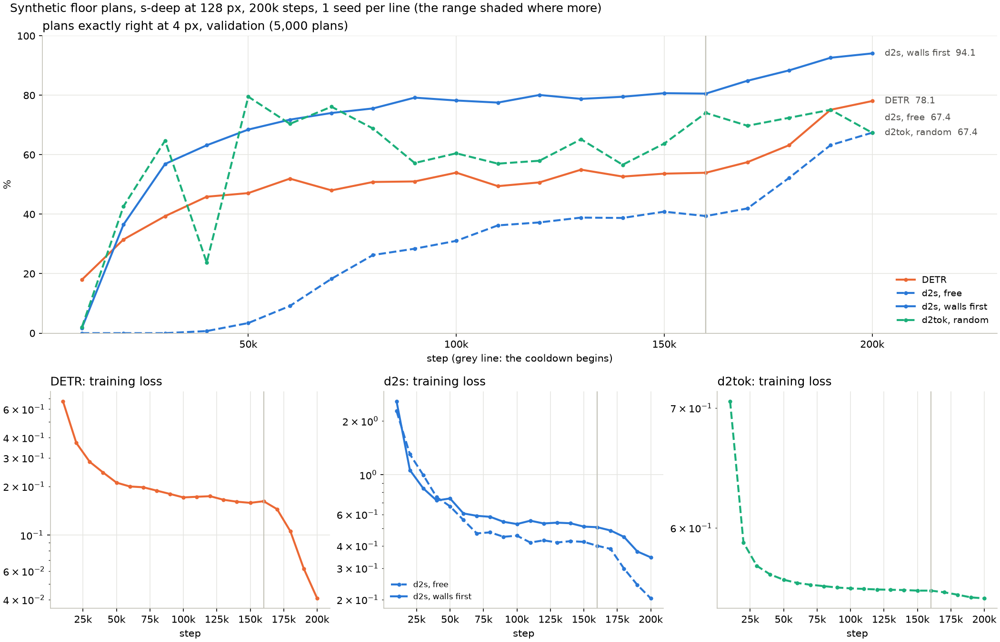

# Synthetic floor plans: results

Transcribing a drawn floor plan into its walls, doors and windows, on
[benikm91/synthetic-floorplans-for-transcription](https://huggingface.co/datasets/benikm91/synthetic-floorplans-for-transcription).
A node is a horizontal or vertical segment, given by its two ends and one of five classes: outside
wall, inside wall, door, outside door, window. A plan has 7–71 nodes, 42 on average. The drawings
are stored at 512 px, and the models read them at 128 px. Test split: 5,000 plans.

All models are `s-deep`, about 11.3M parameters, with the same document encoder, trained for 200k
steps (learning rate cooldown from 160k). There is one seed, seed 0, for every configuration so far.
The scores are of the last checkpoint. Where every number comes from is at the end.

## The models

| model | what it writes | in which order |
|---|---|---|
| **DETR** | all nodes at once, from 73 queries (the most nodes a training plan holds), Hungarian matching | none |
| **d2s** | the next node, trained against the set of the nodes still to write | none (*free*), or class by class (*walls first*) |
| **d2tok** | the next word of the record: a class word, then four coordinate words (the pixels of the two ends) | a fresh random order (*random*); *walls first* as for d2s |

The *walls first* order goes outside walls, inside walls, outside doors, doors, then windows, in a
fresh random order within a class. Everything is decoded greedily. d2tok's decoding is not
constrained to well-formed records. Relationships (*joined*, *in*) are in the data, but no model
here writes them.

## Main table

At 4 px, a node is found when its class is right and both ends are within 4 px in x and y, on the
128 px canvas (16 px of the stored drawing). A plan is exactly right when every target node is
found and nothing else is written.

| model | order | parameters | seeds | plans exactly right | node F1 | nodes found | nodes right |
|---|---|---|---|---|---|---|---|
| DETR | – | 11.26M | 1 | 78.4 | 99.5 | 99.3 | 99.6 |
| d2s | free | 11.32M | 1 | 67.1 | 98.1 | 97.8 | 98.5 |
| d2s | walls first | 11.32M | 1 | **94.1** | **99.8** | **99.8** | **99.8** |
| d2tok | random | 11.28M | 1 | 67.2 | 99.5 | **99.8** | 99.2 |
| d2tok | walls first | | | *pending* | | | |

### Plans exactly right, by tolerance

| model | order | 2 px | 4 px | 8 px |
|---|---|---|---|---|
| DETR | – | 77.9 | 78.4 | 78.0 |
| d2s | free | 65.2 | 67.1 | 70.3 |
| d2s | walls first | **92.5** | **94.1** | **94.2** |
| d2tok | random | 66.9 | 67.2 | 66.8 |

Validation (5,000 plans) agrees with test to within half a point for every configuration. The
script prints it too.

### What the table says

- **d2s in walls-first order is 16 points ahead** of the next model, DETR, in whole plans. The
  order is worth 27 points to d2s. On the Vitruvion sketches the class order was worth 5.
- **At node level every model is above 98% F1.** The differences are all in whole plans: with 42
  nodes per plan, a 0.5% node error rate loses about a fifth of the plans.

## What the errors are

From `table_floorplans.py`, test, at 4 px. A missed or extra node is given in % of target
nodes. An extra node *repeats a found node* when it is near a found node of the same class.

| | DETR | d2s free | d2s walls first | d2tok random |
|---|---|---|---|---|
| missed | 0.67 | 2.16 | 0.24 | 0.15 |
| extra: a repeat of a found node | 0.23 | 0.09 | 0.01 | 0.56 |
| extra: other | 0.19 | 1.45 | 0.18 | 0.28 |
| extra: of them doors | 0.04 | 0.56 | 0.04 | 0.73 |
| too few written (% of plans) | 12.32 | 16.98 | 2.34 | 1.76 |
| too many written (% of plans) | 5.96 | 1.78 | 0.42 | 29.32 |

- **d2tok misses almost nothing but writes too much.** It finds more nodes than any other model.
  But it writes too many in 29% of the plans, and most of those extra nodes are doors it has already
  written. The rest of its errors are small. Whether the walls-first order helps with that is what
  the d2tok walls-first run is for.
- **d2s free and DETR stop too early.** They write too few nodes in 17% and 12% of the plans.
  The walls-first order cuts d2s's share to 2%.

## The language model

A one-shot baseline on 10 test plans: Claude Fable 5.1 through Claude Code, with one training plan
and its record as the example. The code is `llmBaseline/` on the branch
`synthetic-floorplans-llm-baseline`. The trained models are scored on the same 10 plans, from their
test transcripts.

| model | plans exactly right (2 / 4 / 8 px) | nodes found | nodes right |
|---|---|---|---|
| Claude Fable 5.1, one example | 0 / 10 / 30 | 94.0 | 93.8 |
| DETR | 90 / 90 / 90 | 99.0 | 99.6 |
| d2s, free | 60 / 60 / 80 | 98.6 | 98.8 |
| d2s, walls first | 100 / 100 / 100 | 100.0 | 100.0 |
| d2tok, random | 60 / 60 / 60 | 99.8 | 99.2 |

The language model reads the structure: it finds 94% of the nodes. But it gets 1 plan of the 10
exactly right. Its errors are walls split at the wrong junctions, openings placed a few pixels off,
and outside and inside walls confused. The drawing of the 10 plans is `plans.png` in the project
root, which is not committed.

## Convergence



From `plot_fp.py`: validation every 10k steps, and the training loss. The grey line is where the
cooldown begins.

- **At the full learning rate, the models level off.** DETR stays at 48–55% from 60k to 160k,
  and d2s walls first at 78–81% from 90k. d2s free is still climbing slowly, from 26% at 80k to
  39–41% at 150–160k. The training losses flatten the same way.
- **The cooldown adds 13–28 points** to DETR and to both d2s runs. The scores are still rising at
  200k, where the learning rate reaches zero. The plot shows a plateau before the cooldown, not that
  the final scores are as high as these models can get.
- **d2tok doesn't level off; it jumps** between 57% and 80% from checkpoint to checkpoint from 50k on, and the
  cooldown doesn't settle it: 75% at 190k, 67% at 200k. Its loss is flat from about 100k on. With so
  few nodes missed, what moves is mostly whether it stops in time.

## Reproduce

```
python3 table_floorplans.py
uv run --with matplotlib --with pandas python plot_fp.py
```

## Where the numbers come from

Everything above is recomputed by `table_floorplans.py` from the run folders under `results/runs/`,
as synced from the cluster (`~/.detr-cache/output/<run>`). The training plot is drawn by
`plot_fp.py` from the same folders. Every run folder holds the scores (`*-val.csv`, `*-test.csv`), the last
checkpoint's transcripts (`*-<split>-<step>.jsonl`), the training history
(`checkpoints/…/history.csv`) and `*.environment.json`. That file records the branch, the commit,
the seed, the order and the GPUs.

### The runs

| configuration | run folder | branch @ commit |
|---|---|---|
| DETR | `floorplans-detr-seed0-200k` | `floorplans-200k` @ fd585e5 |
| d2s free | `floorplans-d2s-free-seed0-200k` | `floorplans-d2s-200k` @ 7ce5a8d |
| d2s walls first | `floorplans-d2s-walls-first-seed0-200k` | `floorplans-200k` @ fd585e5 |
| d2tok random | `floorplans-d2tok-random-seed0-200k` | `floorplans-200k` @ fd585e5 |
| Claude Fable 5.1, one example | `floorplans-llm-fable-5-1` | `synthetic-floorplans-llm-baseline` @ afb066c |

- Every 200k run carries on from the checkpoint at 80k of a run of the same name without `-200k`
  (`floorplans-detr-seed0`, …), trained on `synthetic-floorplans` with a cooldown from 80k. Up to
  80k the two schedules are the same, so the checkpoints before it are shared, and their validation
  scores in the plot come from that run's `*-val.csv`.
- Both walls-first orders write outside doors before doors.

### What every run shares

- **Data:** the train split is 450,000 plans in nine parts of 50,000. Validation and test are
  5,000 plans each. The drawings are averaged down from 512 to 128 px, every pixel the mean of the
  4 × 4 block it covers.
- **Recipe:** 200k steps of 512 plans, about 228 passes over the training split. Learning rate
  3e-4, 10k steps of warmup, held, then a cosine cooldown to 0 from 160k. AdamW, β₂ 0.98, weight decay 0.05, gradients clipped to a global
  norm of 1. Mixed precision. A checkpoint every 10k steps.
- **Size:** `s-deep`: six layers on either side, 256 wide, eight heads, the same vision transformer
  encoder. d2s asks a pool of 6 learned queries per slot. DETR has 73 queries.
- **Hardware:** two V100 32 GB per run, the batch split over them.
- **Training time:** DETR about 75k s, d2tok 63k s, d2s 59–60k s.
- **Decoding:** greedy for every model. A d2tok plan of 42 nodes is 211 sequential steps, a d2s
  plan 43, DETR one pass.

### The measures

- The eval stage writes one CSV row per checkpoint and tolerance (0, 2, 4 and 8 px of the 128 px
  canvas). The test split is scored at the last checkpoint only. No checkpoint is selected.
- **Nodes found** is recall, **nodes right** is precision, **node F1** their harmonic mean.
- **Matching:** greedy (`FloorplanScoring`): the target nodes, in their order, each take the first
  written node still free of the same class with both ends within the tolerance. That's why a looser
  tolerance can lose a plan: a node can take a neighbour's partner. For example, d2tok's exact
  plans at 8 px are below 4 px.
- **The language model's table** is scored by the same rules, in Python, from the transcripts.
  This was checked to agree with the Scala scoring on every test plan of DETR and d2tok.
